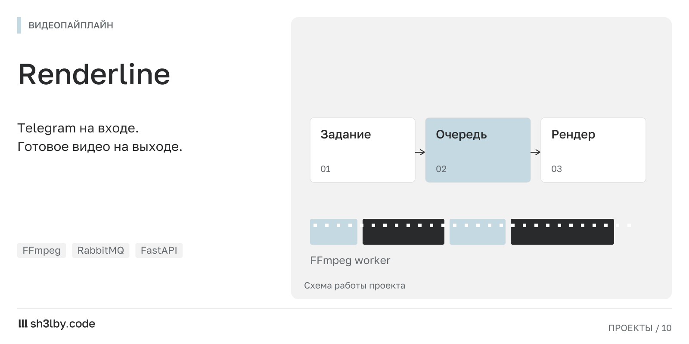

# Renderline

<!-- portfolio-card:start -->
[](docs/portfolio/card.svg)
<!-- portfolio-card:end -->

Собрать вертикальное видео через диалог в Telegram: загрузить клипы, выбрать фрагменты, добавить субтитры и музыку, затем отправить задачу на рендер. Renderline передаёт сборку отдельному FFmpeg-воркеру и возвращает готовый файл в чат.

Сценарий рассчитан на монтаж из заданных материалов. Пользователь явно задаёт начало и конец каждого фрагмента; поверх дорожки можно добавить текст, фоновую музыку и звуковые эффекты по временным меткам.

## От диалога к обработке видео

Бот проводит пользователя по шагам, API хранит проект и его материалы, RabbitMQ передаёт задание воркеру. Воркер строит граф фильтров FFmpeg: обрезка и склейка, формат 9:16, ASS-субтитры и сведение звука. Результат сохраняется в MP4, статус проекта обновляется.

В репозитории можно оценить разделение интерактивного бота и длительной обработки файлов. Публичный демобот пока не подключён; для запуска нужны собственный Telegram-токен и сервисы из Compose.

Обсудить похожий проект: [sh3l.beer](https://sh3l.beer).

## Архитектура

```
Telegram bot ──► FastAPI (projects, assets, timeline, subtitles, audio, overlays, render)
                      │ PostgreSQL (SQLAlchemy 2 + Alembic)
                      ▼
                 RabbitMQ queue ──► render worker (ffmpeg, libass subtitles) ──► storage/output
```

- `bot/`: сценарий на aiogram 3 FSM от создания проекта до отправки на рендер.
- `api/`: REST API для бота и прямых запросов; описание доступно в `/docs`.
- `worker/`: обработка очереди `render_tasks`, сборка фильтров FFmpeg и запись результата.
- `database/`: модели и миграции.

## Запуск

```bash
cp .env.example .env     # set TELEGRAM_BOT_TOKEN
docker compose up -d --build
# API docs: http://127.0.0.1:8000/docs
```

Compose запускает пять контейнеров: postgres, rabbitmq, api, bot и worker. API выполняет миграции при старте. Загруженные материалы и готовые видео хранятся в `./storage`.

Для локального запуска без Docker поднимите Postgres и RabbitMQ, укажите их адреса в `.env`, затем выполните `alembic upgrade head` и запустите `uvicorn api.main:app`, `python bot/main.py`, `python worker/main.py`.

## Проверки

```bash
pytest -q
```

Полное описание функций находится в `docs/spec.md`.

## Лицензия

MIT
